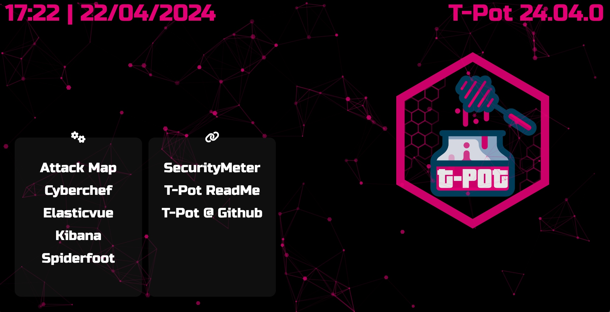
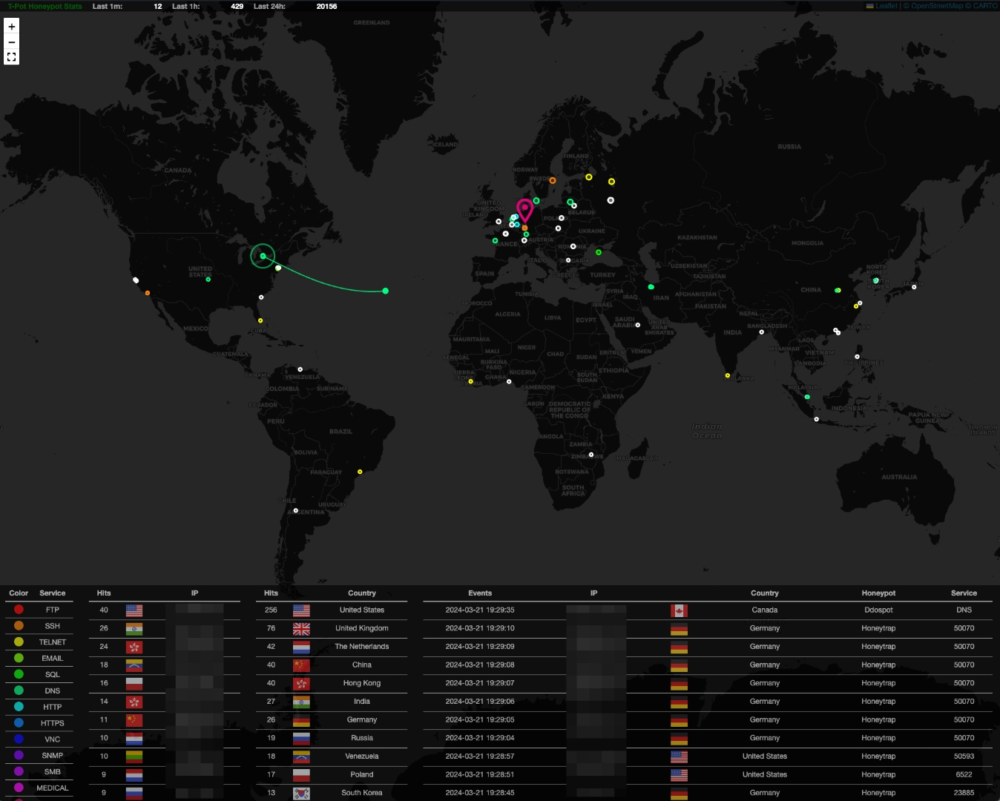
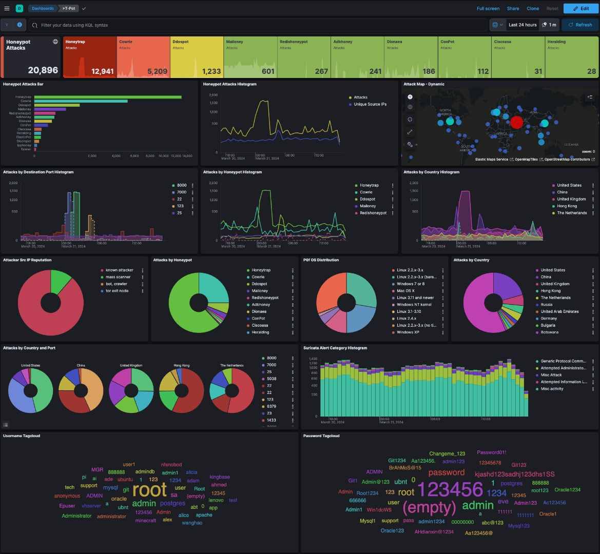

# AWS Honeypot Threat Intelligence

> Observe internet-facing threats through an isolated AWS honeypot and an evidence-led analysis workflow.


AWS Honeypot Threat Intelligence uses T-Pot Community Edition on Amazon EC2 to collect interactions with deliberately exposed decoy services. Logs and Kibana dashboards support investigation of scanning, authentication attempts, suspicious requests, and payload-related activity.

The project demonstrates cloud security, network exposure management, Docker operations, threat detection, log analysis, and incident-response planning. It is intended for students, cloud/security engineers, SOC analysts, and technical reviewers.

> Project status: documentation and deployment plan. Successful deployment, collected telemetry, and analysis results have not been verified here. Supplied screenshots are reference material, not evidence of this project's operation.

## Table of contents

- [What you will build](#what-you-will-build)
- [Threat-intelligence framing](#threat-intelligence-framing)
- [Architecture](#architecture)
- [Security boundaries](#security-boundaries)
- [Prerequisites and configuration](#prerequisites-and-configuration)
- [IAM and account security](#iam-and-account-security)
- [Deployment guide](#deployment-guide)
- [Data handling and analysis](#data-handling-and-analysis)
- [Troubleshooting](#troubleshooting)
- [Incident response](#incident-response)
- [Cost and cleanup](#cost-and-cleanup)
- [Roadmap](#roadmap)
- [Contributing](#contributing)
- [License](#license)
- [Author and contact](#author-and-contact)
- [References and acknowledgments](#references-and-acknowledgments)
- [Responsible use](#responsible-use)

## What you will build

- An isolated EC2 host running a T-Pot Hive deployment with local visualization.
- Selected Docker-based honeypots exposed through explicit security-group rules.
- Restricted host administration and web management.
- A log-analysis workflow that separates observed behavior from attribution.
- A documented shutdown, evidence-preservation, and cleanup process.

No attack results, deployment success, or performance measurements are claimed until independently recorded in this repository.

## Threat-intelligence framing

A honeypot is a decoy system intended to collect interactions that would otherwise be difficult to observe safely. Automated scanners and attackers probe exposed services to discover accessible software, weak authentication, and exploitable behavior.

Depending on the enabled services, telemetry may include connection attempts, authentication guesses, HTTP paths, commands, downloads, or protocol-specific events. Not every probe is malicious: benign research scanners and misconfigured clients also contact exposed systems.

Raw events become useful intelligence when an analyst normalizes fields, groups related activity, checks context, and documents a defensible conclusion. A source generating repeated authentication failures is an observation; identifying its operator or intent requires additional evidence.

> Authorized research and education only. Obtain permission before deployment, review provider terms and local requirements, and isolate the environment from production systems.

## Architecture

```text
Public internet
      |
      v
AWS security group: selected honeypot ports only
      |
      v
Isolated EC2 host -> T-Pot Docker services -> Logs and metrics
                                                  |
                                                  v
                                         Elasticsearch / Kibana
                                                  |
                                                  v
                                          Analyst investigation

Trusted operator IP /32
      |
      +-> TCP 22: bootstrap SSH only, before installation
      +-> TCP 64295: management SSH after installation
      +-> TCP 64297: T-Pot web interface / Kibana access

No connection to production workloads, credentials, or trusted networks
```

Public honeypot traffic and operator traffic reach different service ports. Security groups are additive: a broad rule in either attached group can defeat restrictions in the other. Audit every attached group.

## Security boundaries

| Purpose | Port | Allowed source | Lifecycle |
|---|---|---|---|
| Bootstrap host SSH | TCP 22 | Trusted operator IPv4 `/32` | Before installation only |
| T-Pot management SSH | TCP 64295 | Trusted operator IPv4 `/32` | After installation |
| T-Pot web interface | TCP 64297 | Trusted operator IPv4 `/32` | After installation |
| Selected honeypots | Configuration-dependent TCP/UDP | Public only when deliberately approved | After validation |
| Other management/backend services | No public rule | No internet access | Always |

These management ports follow upstream defaults; verify them against the exact release selected for deployment. Port 22 may become a honeypot port after the administrative SSH service moves.

> Never add public ingress for management ports, Docker APIs, Elasticsearch, or backend dashboards. Do not open all ports to simplify installation. Keep IPv6 disabled unless equivalent IPv6 access controls have been explicitly reviewed.

### Outbound access

Installation, package updates, container pulls, and some honeypot functions need outbound connectivity. Review destinations and protocols, apply tested egress restrictions where feasible, and document any temporary broad access. Restrictive egress can change what the honeypot observes. A host firewall alone is not a substitute for AWS-level controls, particularly with Docker port publishing.

## Prerequisites and configuration

| Requirement | Selection or action |
|---|---|
| AWS environment | Dedicated account and isolated VPC; no production peering or shared secrets |
| Operating system | An OS supported by the selected T-Pot release; record the AMI ID |
| Deployment mode | Hive for local collection and dashboards |
| Resource planning | Upstream baseline: Hive 16 GB RAM / 256 GB SSD; Sensor 8 GB RAM / 128 GB SSD; recheck selected release |
| Network | Public subnet with internet-gateway route and intended public IPv4; verify network ACLs |
| Operator tools | AWS CLI v2, SSH client, browser, authorized AWS identity |
| Authentication | MFA-backed AWS access and a protected EC2 private key |
| Budget | Estimate regional compute, storage, public IPv4, transfer, and retention charges |

### Deployment record

Complete this table after testing; placeholders are not verified configuration.

| Setting | Recorded value |
|---|---|
| T-Pot release / commit | `<TPOT_RELEASE_OR_COMMIT>` |
| OS / AMI / architecture | `<OS_VERSION>` / `<AMI_ID>` / `<ARCHITECTURE>` |
| Region / instance type | `<AWS_REGION>` / `<INSTANCE_TYPE>` |
| EBS root device / size | `<ROOT_DEVICE_NAME>` / `<STORAGE_GB>` |
| Enabled honeypot ports | `<REVIEWED_PORT_LIST>` |
| Validation date | `<VALIDATION_DATE>` |
| Collection window / retention | `<COLLECTION_WINDOW>` / `<RETENTION_POLICY>` |
| Telemetry sharing decision | `<ENABLED_OR_DISABLED_AND_REASON>` |

## IAM and account security

Enable MFA for privileged identities, protect the root user, and use temporary credentials where possible. Enable and verify CloudTrail coverage and retention appropriate to the lab. Never attach production access permissions to the honeypot instance; avoid an instance role unless explicitly needed.

| Illustrative IAM actions | Purpose |
|---|---|
| `sts:GetCallerIdentity` | Confirm the active identity |
| `ec2:Describe*` | Inspect deployment resources; narrow action list where practical |
| `ec2:RunInstances`, `ec2:CreateTags` | Launch and label resources |
| `ec2:CreateKeyPair`, `ec2:DeleteKeyPair` | Manage the lab key pair |
| `ec2:CreateSecurityGroup`, `ec2:DeleteSecurityGroup` | Manage network controls |
| `ec2:AuthorizeSecurityGroupIngress`, `ec2:RevokeSecurityGroupIngress` | Manage inbound rules |
| `ec2:AuthorizeSecurityGroupEgress`, `ec2:RevokeSecurityGroupEgress` | Manage outbound rules |
| `ec2:StopInstances`, `ec2:TerminateInstances` | Isolate by stopping or remove the host |
| `ec2:DisassociateAddress`, `ec2:ReleaseAddress` | Remove an optional Elastic IP |
| `ec2:DeleteVolume`, `ec2:DeleteSnapshot` | Clean up retained storage |
| `cloudtrail:LookupEvents` | Investigate API activity |

This is not a complete IAM policy. Required actions depend on existing VPC resources, encryption, launch options, and evidence collection. Scope supported actions by resource, tags, region, and conditions. Provisioning CloudTrail and budgets requires separately authorized permissions.

## Deployment guide

Commands are templates. Replace all `<PLACEHOLDERS>` before execution; quote string values. Numeric placeholders inside JSON must become actual numbers. Use the same authorized CLI profile and region throughout.

### 1. Verify identity and select configuration

Use your organization's approved sign-in method. For an existing AWS IAM Identity Center profile:

```bash
aws sso login --profile "<AWS_PROFILE>"
export AWS_PROFILE="<AWS_PROFILE>"
export AWS_REGION="<AWS_REGION>"
aws sts get-caller-identity
```

Expected outcome: the returned identity belongs to the dedicated lab account. Stop if the account or role is unexpected.

### 2. Prepare the SSH key

```bash
umask 077
aws ec2 create-key-pair \
  --key-name "honeypot-lab-key" \
  --query 'KeyMaterial' \
  --output text > honeypot-lab-key.pem
chmod 400 honeypot-lab-key.pem
```

Use a new filename and key name if one already exists; shell redirection can overwrite local files. Never commit the key.

Expected outcome: AWS creates the key pair and the private key is readable only by its owner.

### 3. Create security groups

```bash
aws ec2 create-security-group \
  --group-name "honeypot-public-sg" \
  --description "Explicitly approved decoy service ingress" \
  --vpc-id "<VPC_ID>"

aws ec2 create-security-group \
  --group-name "honeypot-management-sg" \
  --description "Trusted operator management ingress" \
  --vpc-id "<VPC_ID>"
```

Record the returned group IDs. Review default outbound rules and apply your tested egress policy.

### 4. Allow bootstrap and future management access

```bash
for PORT in 22 64295 64297; do
  aws ec2 authorize-security-group-ingress \
    --group-id "<MANAGEMENT_SECURITY_GROUP_ID>" \
    --protocol tcp \
    --port "$PORT" \
    --cidr "<TRUSTED_IPV4>/32"
done
```

Expected outcome: only your trusted source can reach these ports. Leave the public honeypot group without inbound rules until installation is complete.

> T-Pot moves administrative SSH from TCP 22 to TCP 64295. Prepare the new restricted rule before installing. Keep an authenticated session available during setup, then verify the new connection after reboot.

### 5. Launch the isolated host

Check the AMI's root-device mapping first:

```bash
aws ec2 describe-images \
  --image-ids "<AMI_ID>" \
  --query 'Images[0].{Name:Name,Architecture:Architecture,RootDeviceName:RootDeviceName}'
```

Use the returned device name, a compatible instance architecture, and the reviewed storage size:

```bash
aws ec2 run-instances \
  --image-id "<AMI_ID>" \
  --instance-type "<INSTANCE_TYPE>" \
  --key-name "honeypot-lab-key" \
  --subnet-id "<SUBNET_ID>" \
  --security-group-ids "<HONEYPOT_SECURITY_GROUP_ID>" "<MANAGEMENT_SECURITY_GROUP_ID>" \
  --associate-public-ip-address \
  --metadata-options 'HttpTokens=required,HttpEndpoint=enabled' \
  --block-device-mappings '[{"DeviceName":"<ROOT_DEVICE_NAME>","Ebs":{"VolumeSize":<STORAGE_GB>,"VolumeType":"gp3","Encrypted":true,"DeleteOnTermination":true}}]' \
  --tag-specifications 'ResourceType=instance,Tags=[{Key=Name,Value=aws-honeypot-threat-intelligence},{Key=Environment,Value=security-lab}]'

aws ec2 wait instance-status-ok --instance-ids "<INSTANCE_ID>"
```

Expected outcome: EC2 status checks pass. Record attached volumes and any separately created networking resources for teardown.

### 6. Connect and install T-Pot

```bash
ssh -i honeypot-lab-key.pem "<OS_USER>@<EC2_PUBLIC_IP>"
```

Verify the host key using an independent trusted method. Install Git using the selected supported OS's documented package manager if needed. Review the upstream installation instructions and installer before proceeding.

Run as the non-root OS user, not through `sudo ./install.sh`:

```bash
git clone https://github.com/telekom-security/tpotce
cd tpotce
git checkout "<TPOT_RELEASE_OR_COMMIT>"
./install.sh
```

Select the Hive deployment appropriate for local dashboards. The installer requests elevated privileges when required. Record the configuration and create unique web credentials without committing them.

Review telemetry sharing and retention before exposing any honeypot service. After successful installation, follow the release's reboot instructions:

```bash
sudo reboot
```

Expected outcome: installation completes without unresolved errors and the host reboots. If installation fails, do not publish the honeypot ports.

### 7. Verify post-installation access

```bash
ssh -i honeypot-lab-key.pem -p 64295 "<OS_USER>@<EC2_PUBLIC_IP>"
sudo docker ps
sudo ss -tulnp
df -h
free -h
```

Expected outcome: management SSH works on the new port, expected containers run, and storage and memory are sufficient. Investigate restarting or unhealthy containers before exposure.

From the trusted operator network, open:

```text
https://<EC2_PUBLIC_IP>:64297
```

Authenticate with the web account created during installation, not the OS SSH credentials. Verify the intended certificate and host identity; follow the selected release's certificate setup guidance.



> Supplied reference screenshot. Tools and versions may differ from your deployment. This image is not proof of a completed installation.

### 8. Remove bootstrap access and expose selected decoys

From the operator's CLI environment, remove the temporary SSH rule after verifying management access:

```bash
aws ec2 revoke-security-group-ingress \
  --group-id "<MANAGEMENT_SECURITY_GROUP_ID>" \
  --protocol tcp --port 22 --cidr "<TRUSTED_IPV4>/32"
```

Review actual container port bindings against the chosen configuration. Add one rule per approved port/protocol; repeat only for services you intend to study:

```bash
aws ec2 authorize-security-group-ingress \
  --group-id "<HONEYPOT_SECURITY_GROUP_ID>" \
  --protocol "<tcp_OR_udp>" \
  --port "<APPROVED_HONEYPOT_PORT>" \
  --cidr "0.0.0.0/0"
```

Do not publish TCP 64295 or 64297. If exposing TCP 22 as a decoy, first confirm that host administrative SSH no longer listens there.

### 9. Validate boundaries and collection

```bash
aws ec2 describe-security-groups \
  --group-ids "<HONEYPOT_SECURITY_GROUP_ID>" "<MANAGEMENT_SECURITY_GROUP_ID>"
```

Check management access from the trusted network and confirm it fails from an authorized external test source outside the allowlist. Validate selected honeypot ports against your own host only. Review service logs and dashboard time filters to confirm event ingestion.

No immediate internet activity is guaranteed. An empty dashboard alone does not prove failure. Document the test time, configuration, expected results, and actual results.

## Data handling and analysis

### Telemetry sharing and retention

Upstream T-Pot documents community telemetry submission enabled by default. Review the pinned release's sharing settings and opt-out procedure before collection. Record your decision, permitted recipients, retention window, and deletion process.

Logs may contain source addresses, attempted credentials, payloads, and other sensitive content. Restrict access, sanitize published samples, and never execute captured payloads on the host or your workstation. Malware analysis belongs in a separate authorized sandbox.

### Attack activity map



> Supplied reference screenshot, not a live feed or verified telemetry from this AWS deployment. Displayed counts and timestamps are not project results.

The map provides a geographic view of events. Geography describes an estimated source location, not the attacker's identity or nationality.

### Kibana dashboard



> Supplied reference screenshot. Replace it with a sanitized screenshot from your own deployment when publishing findings. Dashboard fields and layouts depend on release and configuration.

1. Select the collection window and record the timezone.
2. Confirm the relevant data view and timestamp field.
3. Filter by service, source, destination port, and event type.
4. Inspect representative raw events behind aggregate panels.
5. Correlate repeated behavior and document uncertainty.

| Metric | Useful question | Interpretation limit |
|---|---|---|
| Event volume | When did activity rise or fall? | Events are not unique attackers |
| Source geography / ASN | Which networks appear most often? | Proxies and compromised hosts obscure origin |
| Targeted ports / protocols | Which exposed decoys receive attention? | Unexposed services cannot be compared |
| Credential attempts | Which guessing patterns recur? | Avoid publishing sensitive raw values |
| Malware-related events | Were URLs, commands, or downloads recorded? | A recorded attempt is not proof of execution |
| Time trends | Do bursts overlap across services? | Consider downtime and collection gaps |

Describe behavior rather than overclaiming attribution: “Repeated SSH authentication failures were recorded in the selected window” is more defensible than “This country attacked the server.” Record exposure configuration, event definitions, collection duration, and data gaps alongside every result.

## Troubleshooting

| Symptom | Checks | Next action |
|---|---|---|
| Bootstrap SSH timeout | Public IP, route, network ACL, trusted `/32`, instance status | Correct the boundary; do not allow all sources |
| SSH fails after installation | New port 64295 and corresponding ingress rule | Reconnect using `-p 64295`; verify service configuration |
| Permission denied | OS username, key, local key permissions | Verify AMI login user and selected key pair |
| Web interface unavailable | TCP 64297, trusted IP, containers, TLS | Review service logs and certificate configuration |
| Installation fails | Supported OS, pinned release, CPU/RAM/disk, egress | Resolve errors before any public exposure |
| Containers restart | `sudo docker logs --tail 100 "<CONTAINER_NAME>"` | Investigate resource pressure and configuration |
| No dashboard events | Time range, ingestion health, active services | Validate with a controlled test against your own host |
| CLI access denied | Profile, role, region, policy conditions | Request the specific required permission |
| IP changed | Operator source and instance public IP | Update exact allowlists; do not broaden them |

## Incident response

Indicators requiring action include unexpected outbound activity, host changes, unauthorized AWS API calls, exposed credentials, and unexpected resources.

1. End collection and isolate the host using your preplanned AWS controls. Removing inbound rules alone is not guaranteed containment; review outbound paths and established connections.
2. Stop the instance when immediate containment takes priority. Confirm its state from a trusted operator environment.
3. Preserve authorized evidence, such as CloudTrail records and restricted snapshots, when practical. Document timestamps and handling.
4. Revoke or rotate exposed credentials and investigate account-level changes.
5. Rebuild from a known-good source rather than trusting a potentially compromised host.

```bash
aws ec2 stop-instances --instance-ids "<INSTANCE_ID>"
aws ec2 wait instance-stopped --instance-ids "<INSTANCE_ID>"
```

> Emergency termination is destructive and can remove evidence. Decide whether preservation or immediate destruction takes priority. Retained snapshots may contain secrets or malicious files and continue to incur charges.

## Cost and cleanup

> AWS charges can continue after you stop collection or stop the instance. Estimate costs before deployment, set budget alerts, and verify every retained resource after teardown. Budget alerts are not a hard spending cap.

| Cost driver | Planning consideration |
|---|---|
| EC2 type and uptime | Size for the selected T-Pot mode and limit the collection window |
| EBS storage | Provisioned capacity persists while stopped; log growth needs monitoring |
| Public IPv4 / Elastic IP | Check current charges for allocated and in-use addresses |
| Snapshots | Retention incurs storage costs after instance termination |
| Data transfer | Investigate outbound volume and applicable regional charges |
| Supporting services | Include CloudTrail delivery/storage and any separately created services |

Use the AWS Pricing Calculator with your actual region and configuration; no fixed price is assumed here.

### Teardown checklist

Run destructive commands only against confirmed lab resource IDs.

- [ ] Export only authorized, sanitized findings and decide what evidence to retain.
- [ ] Terminate the instance and wait for completion.

```bash
aws ec2 terminate-instances --instance-ids "<INSTANCE_ID>"
aws ec2 wait instance-terminated --instance-ids "<INSTANCE_ID>"
```

- [ ] If an Elastic IP was allocated, disassociate it if still associated and release it. Auto-assigned public IPv4 addresses do not have an allocation ID to release.

```bash
aws ec2 disassociate-address --association-id "<ASSOCIATION_ID>"
aws ec2 release-address --allocation-id "<ALLOCATION_ID>"
```

- [ ] Inspect all attached EBS volumes; delete unneeded detached volumes after confirming retention requirements.
- [ ] Delete unneeded snapshots, including any created for investigation, when approved.

```bash
aws ec2 delete-volume --volume-id "<VOLUME_ID>"
aws ec2 delete-snapshot --snapshot-id "<SNAPSHOT_ID>"
```

- [ ] Remove dependent lab network interfaces or references, then delete both security groups.

```bash
aws ec2 delete-security-group --group-id "<HONEYPOT_SECURITY_GROUP_ID>"
aws ec2 delete-security-group --group-id "<MANAGEMENT_SECURITY_GROUP_ID>"
aws ec2 delete-key-pair --key-name "honeypot-lab-key"
```

- [ ] Remove the local private key when no longer needed, following your device's secure-deletion policy.
- [ ] Remove only lab-owned VPCs, subnets, gateways, or other resources created for this project.
- [ ] Review retained logs and snapshots; do not delete organization-required audit records.
- [ ] Check relevant regions for remaining resources and unexpected API activity.
- [ ] Review AWS Billing and Cost Explorer again after usage reporting updates.

## Roadmap

- Terraform or CloudFormation deployment and teardown.
- Automated alerts with reviewed thresholds.
- Centralized logging and access-controlled retention.
- Threat-feed enrichment with provenance and expiry.
- GeoIP and ASN analysis with attribution limitations.
- Tested detection rules and SOC reporting templates.
- Multi-cloud deployment with provider-specific isolation controls.

## Contributing

Open an issue describing the change, test in an isolated environment, and submit a pull request with validation evidence. Document release dependencies and security implications. Never contribute keys, real secrets, unsanitized logs, or captured malware binaries. Report sensitive vulnerabilities privately through `<SECURITY_CONTACT>`.

## License

No repository license has been selected yet. Add an approved `LICENSE` file before advertising this repository as open source. T-Pot and its bundled components retain their respective licenses; a license selected for this project's original documentation or automation does not replace those terms.

## Author and contact

| Field | Value |
|---|---|
| Author | `<YOUR_NAME>` |
| GitHub | `<YOUR_GITHUB_PROFILE_URL>` |
| LinkedIn | `<YOUR_LINKEDIN_PROFILE_URL>` |
| Contact | `<YOUR_PUBLIC_CONTACT>` |

## References and acknowledgments

- [T-Pot Community Edition: installation, requirements, ports, and telemetry sharing](https://github.com/telekom-security/tpotce)
- [AWS EC2 security groups](https://docs.aws.amazon.com/AWSEC2/latest/UserGuide/ec2-security-groups.html)
- [AWS IAM](https://docs.aws.amazon.com/iam/)
- [AWS CloudTrail](https://docs.aws.amazon.com/cloudtrail/)
- [AWS Pricing Calculator](https://calculator.aws/)
- [Kibana documentation](https://www.elastic.co/guide/en/kibana/current/index.html)

Acknowledgments: T-Pot maintainers and component contributors. Supplied T-Pot artwork and screenshots are included as reference material, not original project telemetry. Confirm redistribution permission and required attribution before publishing, and retain visible third-party credits.

## Responsible use

Operate only on infrastructure you own or are explicitly authorized to manage. Follow applicable laws, provider policies, organizational requirements, and privacy obligations. Never use the environment to attack third parties, permit uncontrolled outbound abuse, or connect an intentionally exposed host to trusted production infrastructure.
